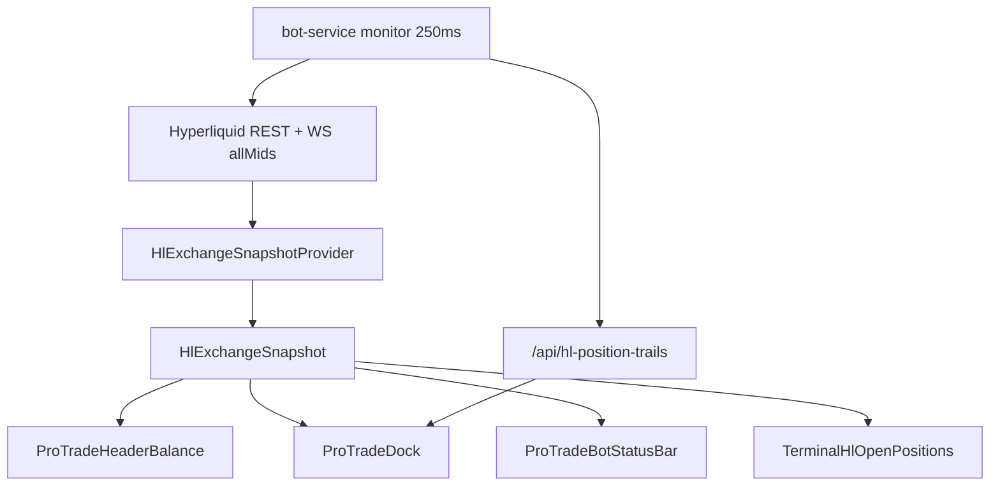

# Dashboard Live Sync — P0 Fixes (14 Nov 2026)

**Branch:** `cursor/regime-deploy-87df264-42a8` · **No production deploy**

## Root causes (accepted audit)

| Issue | Root cause | Fix |
|-------|------------|-----|
| Header ≠ table uPnL | Multiple PnL pipelines + 800 ms vs 5000 ms marks + twin `clearinghouseState` consumers | Single `HlExchangeSnapshotProvider` |
| False “Profit-SL HL” | `lastConfirmedProfitStopPx` memory treated as exchange confirm | API/UI: `profitSlConfirmed` only with open order |
| Slow marks | N× `useHyperliquidMarkPrices` subscribers | One mark poll in snapshot provider (1200 ms) |
| No staleness signal | No `asOf` exposed | `stale`, `positionAgeMs`, `markAgeMs`, tooltips |

## Architecture

**Trading safety:** `runFastPositionMonitor` on Railway is unchanged. Dashboard fixes do not gate SL sync.

## Emergency-SL monitor (investigation)

In `hlTrading.ts` monitor loop, after `syncHlProfitStopOrder`:

- If `plan.emergencyMissing || emergencyDue` and `slPct > 0`, calls `recoverPositionUserStop` (re-post user emergency SL).
- **Detection:** `planProtectiveSync` sets `emergencyMissing` when no matching emergency trigger on HL open orders.
- **Repair:** POST emergency via existing entry-SL exchange path — **not** a strategy change; same recovery as before.
- **Gap:** UI could still show “unverified” while monitor repairs; 8 s trail poll lag on dashboard only.

## SL UI states

| State | Meaning |
|-------|---------|
| **VERIFIED** | Matching reduce-only profit/emergency order on HL (`profitSlConfirmed` / `emergencySlConfirmed`) |
| **UNVERIFIED** | `profitSlMemoryPx` or configured % without HL order |
| **PENDING** | Green + trail phase pending, no confirmed profit order |
| **STALE** | Snapshot older than thresholds (pos 5 s / mark 15 s) |

## Files touched (dashboard commit)

- `src/contexts/HlExchangeSnapshotContext.tsx` (new)
- `src/lib/hlExchangeSnapshot.ts` (+ tests)
- `src/hooks/useHyperliquidMarkPrices.ts` (meta)
- `src/lib/hlTrailingStopChart.ts` (+ verify tests)
- `src/components/protrade/*` Header, Dock, Bot dock/sidebar
- `src/pages/dashboard/Dashboard2ProPage.tsx`
- `bot-service/src/services/hlLiveBotPositions.ts` (confirm policy)

## Remaining risks

1. **Duplicate `useHyperliquidAccount`** in Bot dock (fills/history) vs provider — mitigated by shared `hlInfoClient` 2.5 s cache.
2. **Chart** still uses `useHyperliquidMarket` (12 s candle cache) — mark overlay can lag snapshot marks briefly.
3. **Trail API** still 8 s poll — stop column can lag exchange by seconds; verification now honest (UNVERIFIED vs false VERIFIED).

## Variant D

Unchanged in this commit series (separate trail commit on branch).
