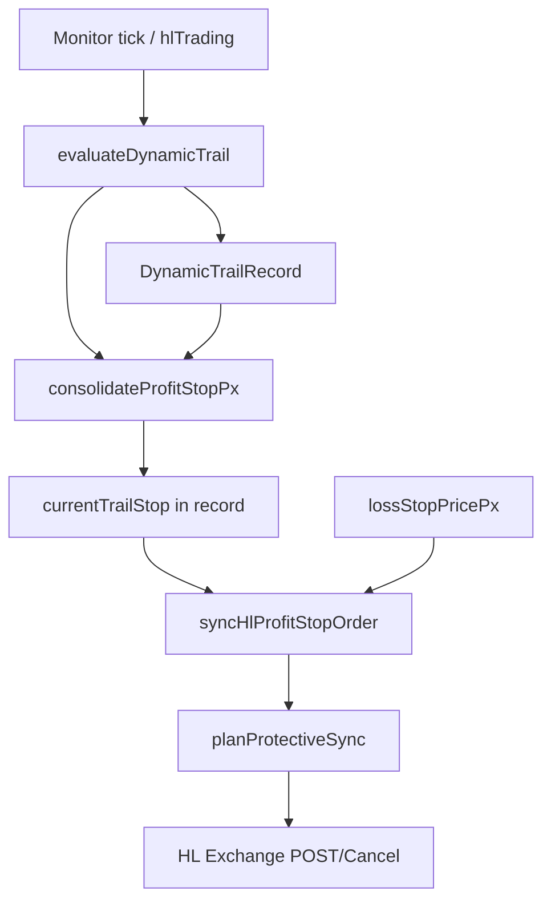

# Variante D — Konsolidiertes mehrstufiges Profit-Trailing (Technische Spezifikation)

**Status:** Design freigegeben zur Implementierung · **kein Deploy** bis Review der Tests  
**Ziel:** Weniger unnötige Micro-Exits, Erhalt von Peak-Locks, unveränderte Emergency-Absicherung, eine Engine (`evaluateDynamicTrail` + `planProtectiveSync` / `syncHlProfitStopOrder`).

---

## 1. Scope und Nicht-Ziele

| In Scope | Out of Scope |
|----------|----------------|
| `bot-service/src/services/dynamicTrailingStop.ts` — Stop-Berechnung & Phasen | Neue parallele Exit-Engine / zweiter Monitor |
| `bot-service/src/services/hlTrading.ts` — Übergabe **eines** `desiredStopPx` | Entry-Gates, Cooldowns, Scalp-Profil S1–S8 |
| `bot-service/src/services/hlProfitStopSync.ts` — POST/Cancel-Plan | UI-Konstanten (`src/lib/hlBotStrategy.ts`) |
| Unit- + Integrationstests (s. §10) | Produktions-Deploy |

**Profil:** Variante D ist das **Default-Verhalten der bestehenden Engine**, sobald implementiert. Optionales Feature-Flag `HL_TRAIL_VARIANT=d` (oder implizit „immer D“ nach Cutover) nur falls Rollback nötig — nicht zwei laufende Trailing-Pipelines.

---

## 2. Terminologie (Profit-Stop-Geometrie)

### LONG

- Profit-Stop **über** Entry.
- **Besserer Schutz** = **höherer** Stop-Preis.
- **Ratchet:** `currentStop = max(current, candidate)` — Stop steigt nur.

### SHORT

- Profit-Stop **unter** Entry, Trigger bei **Anstieg** des Marks.
- **Besserer Schutz** = **niedrigerer** Stop-Preis (mehr Gegenbewegung nötig).
- **Ratchet:** `currentStop = min(current, candidate)` — Stop-Preis fällt nur (numerisch nach unten).

**Glue (Platzierbarkeit):**

- LONG: `gluePx = mark - gapPx`
- SHORT: `gluePx = mark + gapPx`
- HL erlaubt Profit-Stop nur, wenn `profitStopPlaceable` (Abstand Mark, profit-seitig von Entry).

**Glue ist in D kein Trail-Kandidat** (Regel 3). Glue wird nur für Platzierbarkeit und explizite Fallback-Stufen verwendet (§6).

---

## 3. Architektur — eine Engine, zwei Schichten



1. **Logic layer:** `consolidateProfitStopPx()` berechnet aus Peak/Stages/ATR den **strukturellen** Stop und schreibt ihn per Ratchet in `rec.currentTrailStop`.
2. **Exchange layer:** `planProtectiveSync` erhält **dieselbe** `desiredStopPx` (nicht erneut `mark±gap` als Trail).
3. **Emergency SL** bleibt separat; wird **zuerst** gesynct (bestehendes Verhalten beibehalten).

---

## 4. Phasenmaschine (unveränderte Zustände)

| Phase | Bedeutung | Übergang |
|-------|-----------|----------|
| `idle` | Kein Profit-Stop, kein Trail | Grün + Arm-Floor → `pending` oder direkt `armed` |
| `pending` | Arm gewollt, **kein** platzierbarer Stop (§6 Fallback) | Erster platzierbarer Stop → `armed` |
| `armed` | Profit-Stop berechnet; HL-Post ausstehend oder aktiv | Nach erstem konsolidierten Trail-Tick → `trailing` |
| `trailing` | Stage-2 (ATR + Floors aktiv) | Close via Cross oder HL-Trigger |

**Bestehende Felder** (`DynamicTrailRecord`) bleiben; optional neues Feld `postDeferReason?: string` für Logs/Metriken (kein Pflicht-API-Bruch).

**Stage-Anzeige** (`profitProtectionStage`):  
`0` = idle/pending, `1` = armed, `2` = trailing (unverändert).

---

## 5. Konsolidierung — `consolidateProfitStopPx()` (neu, exportiert für Tests)

### 5.1 Inputs

```ts
type ConsolidateStopInput = {
  direction: 'LONG' | 'SHORT';
  entryPrice: number;
  markPrice: number;
  absSize: number;
  tickSize: number;
  feesUsd: number;
  fundingUsd?: number;
  notionalUsd: number;
  // from record:
  highestPriceSinceEntry: number; // favorable extreme (min for SHORT)
  highestPnlSinceEntry: number;
  maxRunup: number;
  currentTrailStop: number | null;
  phase: TrailPhase;
  // config: dynamicTrail.*
};
```

### 5.2 Kandidaten (alle profit-seitig von Entry)

| ID | Quelle (Config) | Berechnung |
|----|-----------------|------------|
| `BE` | `breakevenPlusFeesStopPx` | Mindest-Schutz (Fees + Buffer) |
| `MIN_LOCK` | `minProfitCloseUsd`, `profitStopPxForLockedUsd` | Headline $-Lock |
| `S1` | `stage1PeakKeepFrac` | Peak-PnL × Keep → Preis |
| `STALL` | `stallFloorPeakDropFrac` | Peak × (1 − drop) |
| `FLOOR` | `profitFloorPeakDropFrac` (+ `longProfitFloorPeakDropFrac` für LONG) | Stage-2-Floor |
| `S2_KEEP` | `stage2PeakKeepFrac` | Nur wenn `phase === 'trailing'` |
| `ATR` | `resolveTrailDistancePx` | `extreme ± trailDist` |

**Peak für Stages:** `peakPnl = max(maxRunup, highestPnlSinceEntry)`; Preis aus `peakPnl` wie heute in Replay validiert: `move = lockUsd / absSize`, SHORT `entry - move`, LONG `entry + move`.

**Stage-2 ATR:** `trailDist` von `highestPriceSinceEntry` (favorable), nicht vom aktuellen Mark.

### 5.3 Priorität / Merge (Regeln 2, 4)

**Struktureller Kandidat (ohne Glue):**

- LONG: `structuralPx = max(BE, MIN_LOCK, S1, STALL, FLOOR, [S2_KEEP], ATR)`  
- SHORT: `structuralPx = min(BE, MIN_LOCK, S1, STALL, FLOOR, [S2_KEEP], ATR)`  

`BE`/`MIN_LOCK` wirken als **untere Schranke des Schutzes** (LONG: nicht unter BE; SHORT: nicht **oberhalb** des schlechtesten erlaubten Locks — siehe Implementation: SHORT `structuralPx = min(stageCandidates)` dann `structuralPx = min(structuralPx, entry - eps)` und `structuralPx = max(structuralPx, bePx)` nur wenn `bePx` **looser** wäre — siehe Tests).

**Ratchet** (Regel 4):

```ts
let next = ratchetStop(direction, currentTrailStop, structuralPx);
next = clampStopToProfitSideOfEntry(direction, next, entryPrice);
// Tick-Rundung: formatHlPrice-Richtung für POST, konsistent halten
```

**Wichtig:** `mark ± gap` wird **nicht** in `structuralPx` eingebracht.

### 5.4 Stage-1 vs Stage-2

- Solange `phase === 'armed'`: `S2_KEEP` und voller `ATR`-Trail optional gedämpft (nur `S1` + `STALL` + `MIN_LOCK` + `BE`), **sofern** `armMinRoePct` noch nicht erreicht — analog bestehender Kommentar zu Stage-1/2.
- Übergang `armed → trailing` wenn `roePct >= armMinRoePct` **oder** `phase` bereits `trailing` aus vorherigem Tick.
- In `trailing`: voller Kandidaten-Satz inkl. `FLOOR`, `S2_KEEP`, `ATR`.

### 5.5 Entfernung des Glue-Ratchets in `evaluateDynamicTrail`

**Heute (A):** nach Arm werden `markTrail` und `trailCandidate` per `ratchetStop` auf `currentTrailStop` gemerged (Zeilen ~651–668).

**D:** dieser Block wird ersetzt durch:

```ts
const consolidated = consolidateProfitStopPx(...);
rec.currentTrailStop = consolidated.stopPx;
rec.phase = consolidated.phase ?? rec.phase;
// closeDetail bei pending: consolidated.deferReason
```

Monitor-Close (`shouldClose`) bleibt: Cross gegen `currentTrailStop` + bestehende Close-Gates (`minActive`, `neverRedAfterArm`, `netPnlAfterCosts`, …).

---

## 6. Platzierbarkeit, POST und Fallback (Regeln 5, 6, 7, 8)

### 6.1 Platzierbarkeit

```ts
function isStopPlaceable(...): boolean {
  return profitStopPlaceable({ direction, stopPx, markPx, entryPx, tickSize })
    && profitStopSafeToPost({ ..., breakevenPx: BE, minLockUsd, isMarket: true });
}
```

**Erster POST** nur wenn `armed && isStopPlaceable(postPx)` (Regel 5).

`postPx` = **struktureller** Stop, nicht Glue.

### 6.2 Glue nur als Clamp für Exchange, nicht als Trail

Wenn `structuralPx` nicht placeable:

| Stufe | Aktion | Garantie |
|-------|--------|----------|
| **D-FB-1** | `phase = pending`, **kein Cancel** bestehender Profit-Orders | Regel 6 |
| **D-FB-2** | Wenn `gluePx` placeable **und** `lockedPnlAtStopPx(glue) >= armFloor` | POST `gluePx` als **expliziter Fallback**, Log `TRAIL_POST_GLUE_FALLBACK` |
| **D-FB-3** | Wenn nur `MIN_LOCK` / `profitStopPxForLockedUsd` placeable | POST Min-Lock-Stop, Log `TRAIL_POST_MINLOCK_FALLBACK` |
| **D-FB-4** | Keiner placeable | `pending` bleibt, Log `TRAIL_POST_DEFERRED`, Monitor hält Emergency | **Kein** Verschlechtern vs. A |

**Profit-Schutz-Garantie:** Fallback-Stufen **D-FB-2/3** dürfen nur feuern, wenn `lockedPnlAtStopPx >= profitArmFloorUsd` und net_arm ≥ documented floor — **identisch** zu heutiger Arm-Semantik; neue Logs + Metrics, kein stilles Lock-Reduzieren unter BE.

### 6.3 Updates ohne Schutzverlust (Regel 6)

`planProtectiveSync` / `syncHlProfitStopOrder`:

1. `mergedProfitPx = ratchetStop(direction, reconstructedProfitPx, desiredStopPx)` (bestehend).
2. **Nie** Profit-Order canceln, bevor `postProfit` erfolgreich (bestehend mit Retries) **oder** `desiredStopPx == null && disarm`.
3. Bei Cancel-Failure: `postProfit = null` (bestehend) — Record behält höheren `confirmedExchangeStopPx` via `seedTrailFromConfirmedProfitStop`.
4. `needsTrailTighten`: nur wenn neuer Stop **strikt besser** (LONG höher, SHORT niedriger) als Exchange — sonst `deferTrail`.

### 6.4 Gebühren, Slippage, Tick (Regel 8)

| Zweck | Funktion |
|-------|----------|
| Arm | `netPnlForProfitArm`, `profitArmFloorUsd` |
| Close-Freigabe Monitor | `netPnlAfterCosts` (+ `slippageBufferBps`) |
| Stop-Preis | `hlTickSize`, `formatHlPrice` / Tick-Rundung vor POST |
| POST-Validierung | `profitStopSafeToPost`, `protectiveSideOk` |

Exchange-Status: `reconstructedProfitPx` aus `frontendOpenOrders`; bei `null`-Fetch → **kein POST** (bestehend).

---

## 7. Emergency-SL (Regel 9)

Unverändert:

- `emergencyStopPx = lossStopPricePx(...)` wenn `stopLossPct > 0`.
- `planProtectiveSync` postet Emergency **vor** Profit, unabhängig von `deferTrail`.
- Profit-Stop nutzt `grouping: na` (kein `positionTpsl`), Emergency bleibt parallel.

D berührt Emergency **nicht**.

---

## 8. `hlTrading.ts` — eine Quelle der Wahrheit

**Heute:** `resolveDesiredProfitStopPx` parallel zu `trailResult.record.currentTrailStop`.

**D:** `desiredStopPx = trailResult.record.currentTrailStop` nach `evaluateDynamicTrail` (ein Pfad).  
`resolveDesiredProfitStopPx` nur noch in **Fallback-Resolver** innerhalb von `consolidateProfitStopPx` / POST-Plan, nicht als zweiter Trail in der Monitor-Schleife.

Arm-Gates (`armHoldMs`, `profitArmed`) bleiben; `desiredWithLock` wird aus konsolidiertem Stop + `lockedPnlAtStopPx` abgeleitet.

---

## 9. Konfiguration (bestehende Knobs)

| Env / Feld | Rolle in D |
|------------|------------|
| `stage1PeakKeepFrac` | S1 |
| `stallFloorPeakDropFrac` | STALL (pre-ROE) |
| `profitFloorPeakDropFrac` | FLOOR (trailing) |
| `stage2PeakKeepFrac` | S2_KEEP |
| `armMinRoePct` | armed ↔ trailing |
| `armMinProfitHoldMs` | unverändert (sofortiger Schutz bleibt) |
| `trailMinActiveBeforeCloseMs` | Monitor-Close |
| `minProfitTrailGapBps` / `minProfitTrailGapPx` | nur Glue/Fallback |
| `atrMultiplier`, `majorTrailPct`, … | ATR-Kandidat |

Trend-Hold-Profil (variante C) bleibt **separates** Arm-Gate (`HL_EXIT_PROFILE=trend_hold`) — nicht Teil von D-Default.

---

## 10. Testplan (verbindlich vor Deploy)

### 10.1 Unit — `consolidateProfitStopPx`

| ID | Szenario |
|----|----------|
| U-D-01 | SHORT: Peak steigt → Stop nur **nach unten** (numerisch), nie nach oben ohne Fallback-POST |
| U-D-02 | LONG: Peak steigt → Stop nur **nach oben** |
| U-D-03 | Glue-Mark bewegt sich enger → **structuralPx** unverändert ohne Peak-Update |
| U-D-04 | S1 vs STALL vs FLOOR Reihenfolge bei SHORT 3,93 @ 72,316, peakPnl 0,67 |
| U-D-05 | `pending` wenn structural nicht placeable, BE noch placeable → D-FB-3 |
| U-D-06 | `seedTrailFromConfirmedProfitStop`: confirmed **never loosens** Ratchet |
| U-D-07 | Tick-Rundung: SHORT Stop nicht oberhalb Entry nach Rundung |
| U-D-08 | `armMinRoePct`: vor Schwelle kein voller ATR, danach `trailing` |

### 10.2 Unit — Phasen `evaluateDynamicTrail`

| ID | Szenario |
|----|----------|
| U-D-10 | idle → pending (grün, nicht placeable) |
| U-D-11 | pending → armed (erster placeable POST) |
| U-D-12 | armed → trailing (ROE) |
| U-D-13 | Rot nach Arm: `neverRedAfterArm`, Profit-Cancel-Regeln |
| U-D-14 | Cross + `trailMinActiveBeforeCloseMs` |

### 10.3 Unit — `planProtectiveSync`

| ID | Szenario |
|----|----------|
| U-D-20 | Erster POST: `firstProfitPlacement`, kein Cancel Emergency |
| U-D-21 | Update tighter: cancel + replace; Looser desired → **defer** |
| U-D-22 | Cancel failure → kein neuer POST, alter Stop bleibt |
| U-D-23 | D-FB-2 Glue-Fallback: `wantProfit` true, structural deferred |
| U-D-24 | `reconstructedProfitPx` höher als desired (SHORT) → merged = reconstructed |

### 10.4 Integration

| ID | Szenario |
|----|----------|
| I-D-01 | `profitSlSimulation` + HYPE-Tickpfad (synthetisch, label) |
| I-D-02 | Monitor-Schleife: `confirmedExchangeStopPx` bei API-Flake |
| I-D-03 | SOL-Incident-Scenario: kein Stop oberhalb Entry SHORT |

### 10.5 Golden — HYPE 15:44

Fixtures: `tests/fixtures/hype-2026-11-13-1544-d.json` (Open/Candle-Low/HL-Orders).  
Assert: erster platzierbarer D-Stop ≈ **72,261** (S1), nicht **72,257** (Glue-only A).

---

## 11. HYPE 15:44 — Ereignisreihenfolge (Exchange vs. Simulation)

**Trade:** SHORT 3,93 @ **72,316** · Wallet `0x1fbc…cd84`  
**Zeiten:** UTC (Dubai = UTC+4)

### 11.1 Verifizierte Exchange-Events (HL API)

| # | Zeit (UTC) | Typ | Details |
|---|------------|-----|---------|
| E1 | **15:44:07.269** | **Fill** Open Short | px 72,316, sz 3,93, oid 604118894393, fee 0,12789 |
| E2 | **15:44:01.400** | Fill | USELESS Close (Slot-Kontext; parallel) |
| E3 | **15:45:05.879** | **Order triggered** | HYPE Stop Market, **trigger 72,257**, oid 604120252133 |
| E4 | **15:45:06.938** | Order open / **reduceOnlyCanceled** | Erneuter Stop 72,257, oid 604120284741 |
| E5 | **15:45:09.522** | **Fill** Close Short | px **72,249**, pnl **0,26331**, fee 0,12777 |

**HL 1m Candle (API, kein synthetischer Tick):** Minute 15:44 **L = 72,145** → MFE brutto **(72,316−72,145)×3,93 ≈ $0,672**.

### 11.2 Production A (aus E1–E5 ablesbar)

- Exchange-Stop **72,257** ≈ **$0,232** Brutto-Lock — passt zu **Glue / ~$0,20-Min-Lock**, nicht zu 32 % Peak-Keep auf $0,67.
- Netto **≈ $0,008** nach **~0,256** Fees.

### 11.3 Hypothetische D-Stop-Updates (Simulation)

> **Klarstellung:** Zeilen S* verwenden **keine** HL-Tick-History; Markpfad aus **1m-OHLC + 15s-Interpolation (Schätzung)** und Monitor **250 ms (angenommen)**. Nur E* sind belegt.

| # | Zeit (sim.) | Mark (Schätz.) | Phase | structural stop (D) | placeable? | Aktion (D) |
|---|-------------|----------------|-------|----------------------|------------|------------|
| S0 | 15:44:07 | 72,316 | idle | — | — | Open (E1) |
| S1 | 15:44:08+ | 72,28… | idle→pending | — | — | Grün, Arm-Timer 1s |
| S2 | 15:44:09+ | 72,22… | armed | **S1 ≈ 72,261** (peakPnl≈0,45+) | ja (glue ~72,25) | **POST ~72,261** (sofortiger Schutz) |
| S3 | 15:44:15–30 | **72,145** (1m-L) | trailing | **STALL ≈ 72,231** (peak 0,67) | ja | POST tighten **72,231** (ratchet down) |
| S4 | 15:44:45+ | 72,26 Rally | trailing | 72,231 | ja (stop < glue) | **Kein** Glue-Ratchet auf 72,29 |
| S5 | 15:45:05 | 72,26–72,36 | trailing | 72,231 | — | Trigger **72,231** → Fill ~**$0,33** brutto (**Schätzung**) |
| — | **15:45:05.879** | — | — | — | — | **E3: real A @ 72,257** |

**Vergleich Giveback (brutto, peak $0,67):**

| Modell | Stop | Realisiert ca. | Giveback |
|--------|------|----------------|----------|
| **A (E3–E5)** | 72,257 | $0,26 | ~$0,41 |
| **D (S5)** | 72,231 | ~$0,33 | ~$0,34 |

**Sim vs. Real Delta:** D verhindert in S4 das **Hochziehen** des Stops mit dem Mark (Glue). Real A hat bei Rally **72,257** gehalten (bereits eng); D hätte **72,231** gehalten, wenn Exchange-Update (S3) erfolgreich (Regel 6).

### 11.4 Slot-Belegung (Exchange-Fills, kein Sim)

| Zeit | Belegung |
|------|----------|
| 15:44:07 | XRP + HYPE (2 Slots) |
| 15:45:09 | XRP frei + HYPE flat |
| 15:45:15 | USELESS wieder belegt |

Längeres HYPE-Halten in D hätte in **diesem** Fenster nur die USELESS-Re-Open um Sekunden verzögert — **keine** Hochrechnung auf Tages-PnL.

---

## 12. Implementierungsreihenfolge (nach Spec-Freigabe)

1. `consolidateProfitStopPx` + Unit U-D-01…08  
2. `evaluateDynamicTrail` umbauen (Glue-Ratchet entfernen) + U-D-10…14  
3. `hlTrading` single `desiredStopPx` + I-D-02  
4. Fallback-Logs D-FB-* in `planProtectiveSync` + U-D-20…24  
5. Golden HYPE I-D-01 / Fixture  
6. Review mit dir → **dann** Deploy-Freigabe separat

---

## 13. Abnahmekriterien

- [ ] Alle Tests §10 grün in CI  
- [ ] Kein zweiter Trail-Pfad in `hlTrading`  
- [ ] HYPE Golden: erster POST ≠ Glue-only bei Peak MFE  
- [ ] Emergency-Tests unverändert grün  
- [ ] Fallback-Logs in Staging sichtbar (`TRAIL_POST_*`)

---

## 14. Sicherheitsanforderungen (Exchange, verbindlich)

### 14.1 Kein atomares Replace (HL-API)

Hyperliquid ersetzt Stop-Orders **nicht** atomar. Gültiges Muster:

1. **POST** neue reduce-only Trigger-Order (`grouping: na`).
2. Nach **bestätigtem** Open/Resting die alte Profit-Order **canceln** (nur dann).
3. Bei POST-Fehler: **kein Cancel** bestehender Profit-Orders (Regel 3).

Emergency-POST bleibt **unabhängig** und **vor** Profit-POST; niemals `positionTpsl`-Grouping für Profit (nur ein SL/Position).

### 14.2 Bestätigung nach jedem Stop-Update

Nach jedem erfolgreichen Profit-POST:

- `frontendOpenOrders` erneut lesen.
- Profit-Trigger per `classifyHlTriggerOrder` + `samePx(tick)` gegen **geposteten** `triggerPx` prüfen.
- `rememberConfirmedStops` nur bei Verifikation; sonst Log `TRAIL_POST_VERIFY_FAILED` und **alter** Exchange-Stop bleibt maßgeblich (`seedTrailFromConfirmedProfitStop`).

### 14.3 Fehlerpfad — Schutz behalten

| Fehler | Aktion |
|--------|--------|
| POST reject / timeout | Profit-Orders **nicht** canceln |
| Cancel fail (vor POST) | `postProfit = null` (bestehend) |
| Verify fail nach POST | Alte Orders **nicht** canceln; ggf. Duplikat manuell per nächstem tighten-Zyklus bereinigen |

### 14.4 D-FB-2 Glue — nur POST, nie Trail

- `currentTrailStop` im Record = **nur** `structuralPx` (Stages/ATR/BE).
- Glue erscheint **ausschließlich** in `resolveExchangeProfitPostPx()` für `postProfit.triggerPx`.
- Fallback-Posts loggen `TRAIL_POST_GLUE_FALLBACK`; **kein** `ratchetStop(..., gluePx)` im Monitor.

### 14.5 Niemals lockern (Restart / Recovery)

- `mergedProfitPx = ratchetStop(direction, reconstructedProfitPx, desiredStopPx)` — gewünschter Stop darf Exchange-Stop nur **verschärfen** (LONG höher, SHORT niedriger).
- Bei `desired` lockerer als Exchange: **`deferTrail`**, kein Cancel/POST.
- `seedTrailFromConfirmedProfitStop` beim Restart: confirmed floor für Record-Ratchet.

### 14.6 Gebühren, Tick, Slippage, Size

- Arm/Close: `netPnlForProfitArm`, `netPnlAfterCosts` (+ `slippageBufferBps`).
- Stop-Preise: `profitStopPxForLockedUsd`, `breakevenPlusFeesStopPx`, `hlTickSize` / `formatHlPrice` vor POST.
- `profitStopSafeToPost` inkl. `minLockUsd` aus **aktueller** `absSize` (Partial Fills).

### 14.7 HYPE 15:44 Golden (Fixture)

Datei: `bot-service/tests/fixtures/hype-2026-11-13-1544-d.json`  
Trennung: `events[].kind === "exchange"` vs `"simulated"`.  
Assert: erster platzierbarer **structural** Stop ≈ **72,240** (S1 · `stage1PeakKeepFrac` × Peak ~0,45 USD), nicht Production-Glue **72,257**; POST-Fallback Glue nur wenn structural nicht placeable.

### 14.8 Zusätzliche Testmatrix

| ID | Thema |
|----|--------|
| T-D-PF | Partial fill → kleinere `absSize`, Min-Lock neu |
| T-D-RS | Restart mit `confirmedExchangeStopPx` — kein Lockern |
| T-D-REJ | Exchange reject → Profit-Order bleibt |
| T-D-DUP | Zwei Profit-Trigger → tighten bereinigt nach verify |
| T-D-EM | Emergency + Profit parallel, Emergency unverändert |

**Legacy-Ausweg:** `HL_TRAIL_LEGACY=true` → altes Glue-Ratchet (nur Tests/Rollback).

**Dokumentversion:** 2026-11-14 (Variante D + Sicherheitsanforderungen)
